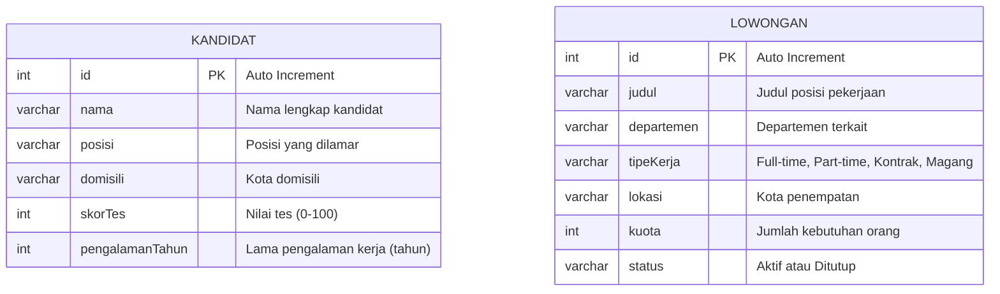
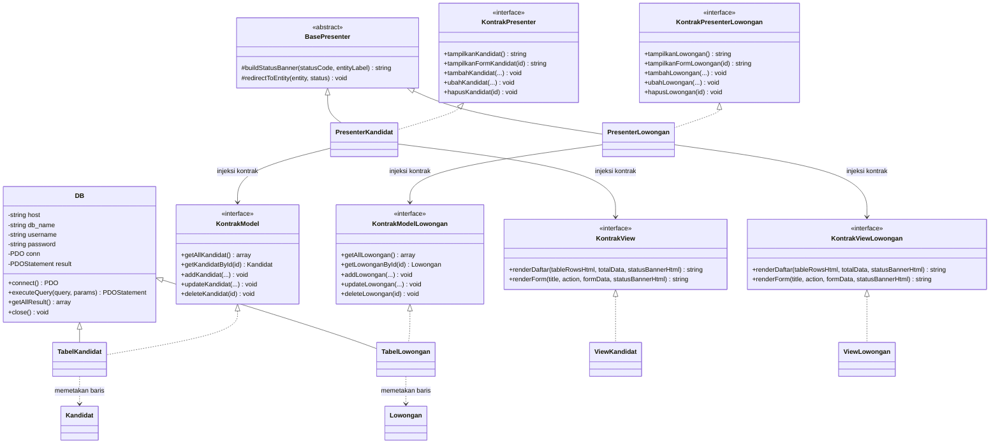
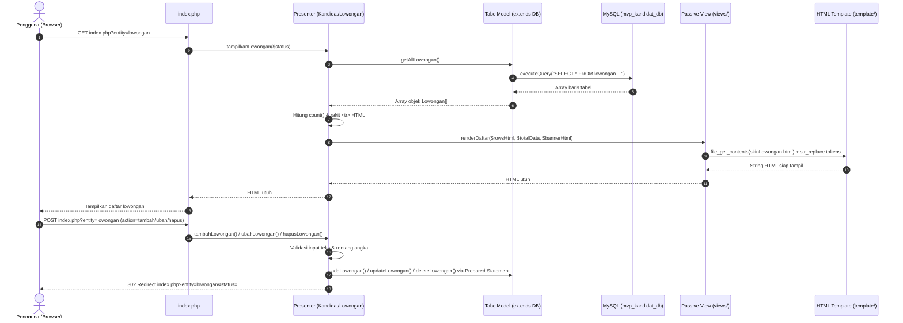

# TP9 DPBO 2025/2026 - Web PHP Native MVP Strict Passive View: Sistem Rekrutmen Kandidat & Lowongan (PDO MySQL, Contract Interfaces, & Vanilla CSS)

Tugas Praktikum 9 mata kuliah Desain dan Pemrograman Berorientasi Objek (DPBO), Program Studi Ilmu Komputer, Fakultas Pendidikan Matematika dan Ilmu Pengetahuan Alam, Universitas Pendidikan Indonesia, semester genap 2025/2026.

---

## Janji Kejujuran Akademik

Saya Devindra Azra Dwi Putra dengan NIM 2509003 mengerjakan TP 9 dalam mata kuliah DPBO untuk keberkahan-Nya maka saya tidak melakukan kecurangan seperti yang telah dispesifikasikan. Aamiin.

---

## 1. Deskripsi Singkat & Fitur Utama Sistem

Aplikasi ini adalah sistem web rekrutmen HR sederhana untuk mengelola data **Kandidat Karyawan** dan **Lowongan Pekerjaan** yang dibangun dengan **PHP Native** menggunakan pola arsitektur **Model-View-Presenter (MVP)** edisi **Strict Passive View (*Dumb View*)**.

Seluruh komunikasi antara komponen **Model**, **View**, dan **Presenter** terikat melalui **Contract Interface** (`KontrakModel*`, `KontrakView*`, `KontrakPresenter*`), seluruh akses basis data MySQL menggunakan **PDO Prepared Statements** (`PDO::ATTR_EMULATE_PREPARES => false`), dan tampilan menggunakan HTML/template token murni dengan **Vanilla CSS** responsif tanpa framework eksternal.

### Fitur-Fitur Utama Sistem:
1. **CRUD Lengkap Tabel `kandidat`**:
   - Menambahkan kandidat baru (`Create`), menampilkan daftar kandidat terurut dari `skorTes` tertinggi (`Read`), memperbarui data melalui form *prefill* (`Update`), dan menghapus kandidat dengan konfirmasi (`Delete`).
2. **CRUD Lengkap Tabel Tambahan `lowongan`**:
   - Mengelola daftar posisi lowongan pekerjaan bertema HR/rekrutmen (`judul`, `departemen`, `tipeKerja`, `lokasi`, `kuota`, `status`) lengkap dengan form tambah, daftar berstatus (`Aktif`/`Ditutup`), form edit *prefill* termasuk `<select>`, dan tombol hapus.
3. **Kepatuhan Strict Passive View (*Dumb View*)**:
   - Seluruh berkas di folder `views/` bebas dari `require_once` Model/Entity, bebas dari `foreach`, dan bebas dari pemanggilan `count()`. View hanya membaca berkas HTML di `template/` dan mengganti token placeholder `{{...}}`.
4. **Navigasi Antar Modul & Pola PRG (*Post/Redirect/Get*)**:
   - Navigasi tab antar halaman `Kandidat` (`?entity=kandidat`) dan `Lowongan` (`?entity=lowongan`), dilengkapi banner status umpan balik (`Berhasil` / `Perhatian`) serta halaman penanganan galat koneksi database.
5. **Tata Letak Responsif & Aksesibilitas**:
   - Mendukung desktop, tablet, dan mobile (kartu tabel bertumpuk di bawah `640px` tanpa *horizontal overflow*), target tombol minimal `44px`, kontras teks sesuai WCAG AA, dan indikator fokus keyboard `:focus-visible`.

---

## 2. Struktur Proyek Modular (Sesuai Modul 10)

Struktur direktori repositori mengikuti ketentuan resmi Modul 10 DPBO:

```text
TP9DPBO2526C2/
├── project/
│   ├── models/
│   │   ├── DB.php                      # Pembantu koneksi PDO & eksekutor prepared statement
│   │   ├── Kandidat.php                # Entity class kandidat
│   │   ├── KontrakModel.php            # Kontrak interface model kandidat
│   │   ├── TabelKandidat.php           # Implementasi CRUD PDO tabel kandidat
│   │   ├── Lowongan.php                # Entity class lowongan
│   │   ├── KontrakModelLowongan.php    # Kontrak interface model lowongan
│   │   └── TabelLowongan.php           # Implementasi CRUD PDO tabel lowongan
│   ├── presenters/
│   │   ├── BasePresenter.php           # Kelas abstrak pembantu status banner & redirect
│   │   ├── KontrakPresenter.php        # Kontrak interface presenter kandidat
│   │   ├── PresenterKandidat.php       # Logika presentasi, perakitan HTML, & validasi kandidat
│   │   ├── KontrakPresenterLowongan.php# Kontrak interface presenter lowongan
│   │   └── PresenterLowongan.php       # Logika presentasi, perakitan HTML, & validasi lowongan
│   ├── views/
│   │   ├── KontrakView.php             # Kontrak interface passive view kandidat
│   │   ├── ViewKandidat.php            # Passive view kandidat (replace token HTML)
│   │   ├── KontrakViewLowongan.php     # Kontrak interface passive view lowongan
│   │   └── ViewLowongan.php            # Passive view lowongan (replace token HTML)
│   ├── template/
│   │   ├── style.css                   # Stylesheet Vanilla CSS responsif
│   │   ├── skin.html                   # Template daftar kandidat ({{TABLE_ROWS}}, {{TOTAL_DATA}})
│   │   ├── form.html                   # Template form tambah/ubah kandidat
│   │   ├── skinLowongan.html           # Template daftar lowongan
│   │   └── formLowongan.html           # Template form tambah/ubah lowongan
│   ├── index.php                       # Front controller & router request GET/POST
│   ├── mvp_db.sql                      # Salinan skrip SQL database
│   └── README.md                       # Panduan ringkas folder project
├── dokumentasi/                        # Folder penyimpanan screenrecord pengujian program
├── mvp_db.sql                          # Export SQL terbaru (tabel kandidat & lowongan)
└── README.md                           # Dokumentasi lengkap TP9
```

---

## 3. Desain Basis Data & Skema Tabel

Basis data `mvp_kandidat_db` berisi dua tabel bertema rekrutmen yang berdiri independen tanpa relasi *Foreign Key* wajib:



### Kamus Data

#### A. Tabel `kandidat`
| Nama Kolom | Tipe Data | Keterangan |
| :--- | :--- | :--- |
| `id` | `INT(11)` (PK, AI) | Identifikator unik kandidat. |
| `nama` | `VARCHAR(100)` (NOT NULL) | Nama lengkap kandidat. |
| `posisi` | `VARCHAR(100)` (NOT NULL) | Posisi pekerjaan yang dilamar. |
| `domisili` | `VARCHAR(100)` (NOT NULL) | Kota domisili pelamar. |
| `skorTes` | `INT(11)` (NOT NULL, Default 0) | Skor tes evaluasi (0-100). |
| `pengalamanTahun` | `INT(11)` (NOT NULL, Default 0) | Lama pengalaman kerja dalam satuan tahun. |

#### B. Tabel `lowongan`
| Nama Kolom | Tipe Data | Keterangan |
| :--- | :--- | :--- |
| `id` | `INT(11)` (PK, AI) | Identifikator unik lowongan. |
| `judul` | `VARCHAR(120)` (NOT NULL) | Judul posisi yang dibuka. |
| `departemen` | `VARCHAR(100)` (NOT NULL) | Nama departemen/divisi pemohon. |
| `tipeKerja` | `VARCHAR(50)` (NOT NULL) | Tipe ikatan kerja (`Full-time`, `Part-time`, `Kontrak`, `Magang`). |
| `lokasi` | `VARCHAR(100)` (NOT NULL) | Lokasi penempatan kerja. |
| `kuota` | `INT(11)` (NOT NULL, Default 1) | Jumlah kebutuhan kandidat. |
| `status` | `VARCHAR(30)` (NOT NULL, Default `'Aktif'`) | Status rekrutmen (`Aktif` atau `Ditutup`). |

---

## 4. Desain Arsitektur Kelas MVP (`Class Diagram`)



---

## 5. Alur Program & Kepatuhan Strict Passive View

### A. Siklus Request-Response MVP



### B. Bukti Kepatuhan Arsitektur
1. **Strict Passive View di `views/`**:
   - `ViewKandidat.php` dan `ViewLowongan.php` hanya mengimpor file kontrak view masing-masing (`KontrakView.php` / `KontrakViewLowongan.php`), tidak memiliki `require_once` ke `models/`, tidak mengandung `foreach`, dan tidak memanggil `count()`.
   - Perubahan nilai `<select>` saat mode edit pada `ViewLowongan::renderForm()` ditangani lewat substitusi token `{{TIPE_*}}` dan `{{STATUS_*}}` di template.
2. **Keamanan Prepared Statements di `models/`**:
   - Seluruh operasi baca/tulis pada `TabelKandidat.php` dan `TabelLowongan.php` memanggil `$this->executeQuery($query, $params)` pada kelas induk `DB.php` dengan parameter bernama (`:id`, `:nama`, `:judul`, dst.) dan `PDO::ATTR_EMULATE_PREPARES => false`.

---

## 6. Cara Menjalankan Aplikasi

1. Salin folder `project/` ke direktori web server lokal (misal `C:\xampp\htdocs\TP9DPBO2526C2\project` atau `C:\laragon\www\...`).
2. Aktifkan layanan **Apache** dan **MySQL** melalui XAMPP/Laragon.
3. Buka `http://localhost/phpmyadmin`, buat atau pilih database, lalu impor berkas `mvp_db.sql` yang tersedia di root repositori (atau di dalam `project/mvp_db.sql`).
4. Buka `http://localhost/TP9DPBO2526C2/project/index.php` melalui browser.
